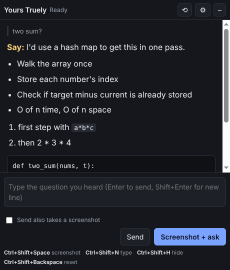

# Yours Truely

A Windows desktop copilot for **practice and mock interviews**. Press a hotkey and it takes a screenshot of your screen, reads the question with a vision AI model, and shows an answer written to be **said out loud**: one opening sentence, then a few short talking points.

It's a normal, visible window. It doesn't try to hide from screen sharing or from the meeting app.



---

## 1. Quick start (Windows)

### Option A: download the ready-made `.exe`
1. Open the repo's **Actions** tab on GitHub → the latest **Build Windows app** run → download **YoursTruely-windows-portable** under *Artifacts*.
2. Unzip it and double-click `Yours Truely 0.1.0.exe`. It's "portable", meaning nothing gets installed; the exe *is* the app.
3. Windows SmartScreen may warn you because the exe isn't code-signed (signing needs a paid certificate). Click **More info → Run anyway**.

### Option B: run from source
1. Install **Node.js 22 LTS** from <https://nodejs.org> (this also installs `npm`, Node's package manager).
2. In a terminal:
   ```bash
   git clone https://github.com/AXSHATJHA/Yours-Truely.git
   cd Yours-Truely
   npm install      # downloads Electron and the AI libraries into node_modules/
   npm start        # compiles the TypeScript and opens the app
   ```
   Run these inside the folder that contains `package.json`. If you downloaded the ZIP from GitHub instead of cloning, it may unzip as `Yours-Truely-main\Yours-Truely-main\`; go into the inner folder.
3. To build your own `.exe`: `npm run dist`. It ends up in `release/`.

### First run
The Settings window opens automatically:
1. **Your profile**: who you are (details in section 3).
2. **This interview**: company, role, job description.
3. **AI model**: paste your Anthropic API key (from <https://console.anthropic.com> → API Keys), or pick **Groq** and paste a Groq key (section 5), or set up an open-source model (section 5).
4. Click **Save**.

---

## 2. Using it in an interview

| Hotkey (default) | What it does |
|---|---|
| `Ctrl+Shift+Space` | Screenshot the monitor your mouse is on, then answer |
| `Ctrl+Shift+N` | Jump to the text box so you can type the question you heard |
| `Ctrl+Shift+H` | Show or hide the window |
| `Ctrl+Shift+Backspace` | New session: forget earlier questions |

You can change all of these in Settings.

**Two ways to ask:**
- **The question is on screen** (a coding problem, a shared doc, a chat message): press `Ctrl+Shift+Space` or click **Screenshot + ask**. These always take a screenshot.
- **The question was spoken** (most voice interviews): press `Ctrl+Shift+N`, type a few words such as "why leaving current job" or "design url shortener", and press **Enter** or click **Send**. These send text only, unless you tick *Send also takes a screenshot*.

If there's text in the box when you take a screenshot, it's sent along with the screenshot.

If a request fails (network blip, rate limit), a **Retry** button appears. The app also retries automatically twice before showing an error.

**Follow-ups work.** The app remembers the last 6 questions and answers of the session, so "how would you make it faster?" makes sense after a coding answer. Press the new-session hotkey between interviews.

**Reading the answer:** the yellow **Say:** line is your opening sentence, so say it right away to buy a few seconds. The bullets are what to cover next, in order. **If they push:** is a ready follow-up.

---

## 3. Writing a good profile

The profile is the part that makes answers sound like *you*. The model is told to **use only experience that's in your profile and never invent any**. So if your profile is thin, behavioural answers will stay generic.

Include:
- Education, roles and internships with dates.
- 3 to 6 stories you like telling, each with **what you did** and **a result with a number** ("cut p95 latency from 800 ms to 300 ms").
- Your tech stack and your preferred coding-interview language.
- Answers you've prepared: "why this field", a strength, a weakness, a conflict story, a failure story.

Plain notes are fine. It doesn't need to be polished prose.

---

## 4. Anthropic models: which to pick

| Model | Speed | Best for | Rough cost per question* |
|---|---|---|---|
| **Claude Haiku 5.5** (default) | Fastest | Behavioural, conceptual, easy/medium coding | ~$0.0005 |
| **Claude Sonnet 5.5** | Medium | Harder coding, system design | ~$0.01 |
| **Claude Opus 5.5** | Slowest | The hardest problems, when you can wait | ~$0.02 |

\*Estimate for one screenshot (~1,800 tokens), the prompts (~1,500 tokens) and a ~300-token answer, at list prices. Your real cost depends on how long your profile is and how long answers get.

**Thinking effort** controls how long the model reasons before it starts writing. *Low* is the default because in a live conversation, a decent answer in 2 seconds beats a perfect one in 15.

For Sonnet and Opus the app also turns on Anthropic's **server-side fallback**: if the model declines a request, the API automatically retries it on another model in the same call instead of returning nothing.

---

## 5. Groq and open-source models

### Groq (hosted Qwen 3.8 27B, very fast, has a free tier)
Groq runs open models on its own chips, which makes answers start in well under a second.
1. Get a key at <https://console.groq.com> → API Keys (it starts with `gsk_`).
2. In Settings choose **Groq**, paste the key, keep the model `qwen/qwen3.8-27b`, click **Save**.

Settings, and why they exist:
- **Thinking**: Qwen 3.8 is a *reasoning* model, meaning it can think privately before answering. `Default` lets it decide; `None` answers straight away (fastest); `High` is best for hard coding problems but slower. The thinking itself is hidden: you only see the answer.
- **Max answer length (tokens)**: a hard cap on the reply. Thinking counts toward it. On Groq's free tier the account is limited to about **1000 output tokens per minute**, and Groq rejects any request that *asks* for more than that, even before answering. So the default is 1000. If you upgrade your Groq plan, you can raise it.
- **Screenshots work**: `qwen/qwen3.8-27b` accepts images (up to 3 per request; the app sends one). If you switch to a text-only Groq model, use "Type a question" instead.

Compared with Claude: Groq + Qwen is faster and cheaper; Claude is usually stronger on tricky coding and system design, and follows the answer format a little more reliably.

### Open-source / OpenAI-compatible

This provider speaks the "OpenAI-compatible" API. That's a request format many tools copy, so one setting covers several options:

### Ollama (local, free)
1. Install from <https://ollama.com>.
2. In a terminal: `ollama pull qwen2.5vl:7b` (about 6 GB). You need a model that can *see images*. Other options: `llama3.2-vision`, `gemma3:12b`.
3. In Settings, choose **Open-source / OpenAI-compatible**, Base URL `http://localhost:11434/v1`, model `qwen2.5vl:7b`.

**Trade-off:** without a decent NVIDIA GPU (8 GB+ VRAM), local vision models can take 10 to 30+ seconds per answer, which is too slow for live use. Local 7B models are also noticeably weaker than Claude at coding and following the answer format.

### OpenRouter (hosted open models)
Base URL `https://openrouter.ai/api/v1`, your OpenRouter key, and a vision model id from their site, e.g. `qwen/qwen2.5-vl-72b-instruct`.

---

## 6. How it works

```
 you press Ctrl+Shift+Space
          │
          ▼
 ┌──────────────── main process (Node.js: src/main.ts) ────────────────┐
 │ 1. make the overlay transparent for ~120 ms                         │
 │ 2. capture the monitor under the mouse (desktopCapturer)            │
 │ 3. shrink to ≤1568 px on the long side, encode as JPEG              │
 │ 4. build the system prompt = voice rules + profile + interview      │
 │ 5. send prompt + last 6 Q&As + screenshot to the model, streaming   │
 └─────────────────────────────┬───────────────────────────────────────┘
                               │ text chunks over IPC, as they arrive
                               ▼
 ┌──────────── overlay window (web page: src/renderer/overlay.ts) ─────┐
 │ renders the Markdown answer live: Say line, bullets, code           │
 └─────────────────────────────────────────────────────────────────────┘
```

Some terms used above:
- **Electron** splits an app into a **main process** (full Node.js access: windows, hotkeys, network) and **renderer processes** (each window is a sandboxed web page). They talk over **IPC** (inter-process communication), which means named messages sent back and forth.
- The **preload script** (`src/preload.ts`) is the only bridge. It exposes a short list of functions as `window.api`, so even if an answer contained malicious text, the page couldn't touch your files.
- **Streaming** means the model sends its answer token by token. You can start reading after about a second instead of waiting for the whole answer.
- **Why make the overlay transparent before capturing?** Otherwise the overlay would be in its own screenshot, covering part of the question.
- **Why resize to 1568 px?** Claude scales larger images down to about that size anyway, so sending more pixels only makes the upload slower.
- **Prompt caching:** the system prompt (rules + profile + interview) is identical for every question in an interview. It's marked cacheable, so Anthropic can reuse it, which makes repeat requests faster and cheaper.
- **Why only the newest screenshot?** Earlier turns are sent as text only. Re-sending old images on every question would slow each request down.

### Where your data goes
- Settings are stored in `%APPDATA%\yours-truely\settings.json`.
- API keys are encrypted with Windows' own DPAPI (through Electron's `safeStorage`), which ties them to your Windows account.
- Screenshots are kept in memory only and sent to the provider you chose. Nothing is saved to disk.

---

## 7. Project layout

```
src/
  main.ts          windows, hotkeys, screenshot, the ask() pipeline
  providers.ts     Anthropic, Groq + OpenAI-compatible streaming, error messages
  think.ts         hides <think>…</think> reasoning if a model writes it into the answer
  prompts.ts       the voice-answer rules and how the system prompt is assembled
  store.ts         settings file + encrypted API keys
  preload.ts       the safe bridge exposed to the windows as window.api
  renderer/
    markdown.ts    a tiny, HTML-safe Markdown renderer for answers
    overlay.ts     the answer window
    settings.ts    the settings window
test/              tests for the Markdown renderer and <think> filter (run with `npm test`)
static/            HTML + CSS for both windows
.github/workflows/ builds the Windows .exe on every push to main
```

To change **how answers sound**, edit `VOICE_RULES` in `src/prompts.ts`. That's the most useful file to tweak.

---

## 8. Troubleshooting

| Problem | Fix |
|---|---|
| "Hotkey not available" | Another app already uses that combination. Pick another in Settings, e.g. `Alt+Q` or `F8`. |
| "Anthropic rejected the API key" | Re-paste the key. Check you have credit at console.anthropic.com. |
| "Groq's per-minute token limit … is lower than this request needs" | Lower **Max answer length** to 1000 or less (free tier), or wait a minute. |
| "Groq rejected the API key" | Re-paste the key from console.groq.com. |
| "Couldn't reach the open-source model server" | Start Ollama (it runs in the system tray) and check the Base URL. |
| Answer is about the wrong thing | Type the question in the box. A screenshot alone can't hear a spoken question. |
| Overlay covers the question | Drag it by its title bar, or hide it with `Ctrl+Shift+H` before capturing. |

## License
MIT. See [LICENSE](LICENSE).
